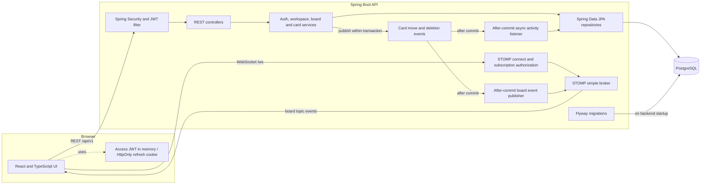

# Modus

Modus is a collaborative Kanban application for organizing work across workspaces, boards, lists, and cards. It combines a React/TypeScript client with a Spring Boot API, PostgreSQL persistence, and live board updates over WebSocket/STOMP.

## What it does

- Create an account, sign in, and stay signed in with short-lived JWT access tokens and rotating refresh tokens.
- Create workspaces and invite existing users. Membership begins only when an invitee accepts an invitation in the app.
- Manage workspace members, rename a workspace, or archive and restore it. Archiving preserves its boards, lists, and cards.
- Create boards, lists, and cards; drag cards between lists. Card moves use optimistic locking to detect conflicting edits.
- See committed card moves and deletions on other subscribed board tabs. Card moves are also recorded in an asynchronous activity log.
- Permanently delete individual cards, lists, or boards. Workspace deletion is an archive operation instead.

Owners manage workspace settings and invitations. Board and list deletion is owner-only; members can create and move cards. The API enforces permissions independently of the UI.

## Stack

| Layer | Technology |
| --- | --- |
| Frontend | React, TypeScript, Vite, Axios, STOMP |
| Backend | Java, Spring Boot, Spring Security, Spring Data JPA, WebSocket/STOMP |
| Data | PostgreSQL, Flyway migrations |
| Local infrastructure | Docker Compose for PostgreSQL |

## Architecture



The data hierarchy is **workspace → board → list → card**. A separate workspace-membership record connects each user to a workspace and determines their role; an invitation does not create that membership until it is accepted.

For a card move, the backend verifies the access token and workspace membership, updates the card in a transaction, and checks its version for concurrent edits. Only a committed move is broadcast to authorized board subscribers. A separate asynchronous listener records the activity, so logging does not hold up the move response.

The diagram describes the current local architecture: Docker Compose runs PostgreSQL, while the frontend and backend run as local processes.

## Run locally

Prerequisites: Docker with Compose, JDK 17 or newer, Node.js compatible with the project's Vite version, and pnpm. The repository includes a Maven wrapper, so a separate Maven installation is not required.

From the repository root, start PostgreSQL:

```powershell
docker compose up -d postgres
```

In a second PowerShell terminal, start the backend:

```powershell
cd backend
.\mvnw.cmd spring-boot:run
```

The API runs at `http://localhost:8080`. Flyway applies pending migrations when the backend starts; JPA validates the schema rather than creating it.

In a third terminal, start the frontend:

```powershell
cd frontend
pnpm install --frozen-lockfile
pnpm dev
```

Open **http://localhost:5173**. Use `localhost` rather than `127.0.0.1`: the development authentication-origin and WebSocket settings are configured for `http://localhost:5173`. Vite proxies `/api` and `/ws` to the backend, so the browser uses one origin during development.

On macOS/Linux, use `./mvnw spring-boot:run` inside `backend` instead of `mvnw.cmd`.

## Try a collaboration flow

1. Register two accounts and sign in with the first one.
2. Create a workspace, a board, a few lists, and a card.
3. Open the workspace settings and invite the second account's email address.
4. Sign in as the second user, open **Invitations**, and accept. The workspace is now available to that account.
5. Move a card between lists. Another tab subscribed to the board receives the move after the database transaction commits; the board's **Activity** view shows the recorded move.
6. As the owner, archive the workspace from its settings. Restore it from **Archived** to access its existing content again.

Invitations currently appear **inside Modus only**; the application does not send invitation emails.

## API overview

The backend exposes versioned endpoints under `/api/v1`:

| Area | Representative endpoints |
| --- | --- |
| Authentication | `POST /auth/register`, `/auth/login`, `/auth/refresh`, `/auth/logout` |
| Workspaces | `GET/POST /workspaces`, `PATCH/DELETE /workspaces/{workspaceId}`, `POST /workspaces/{workspaceId}/restore` |
| Invitations | `POST /workspaces/{workspaceId}/invitations`, `GET /workspace-invitations`, `POST /workspace-invitations/{invitationId}/accept` |
| Boards and lists | `GET/POST /workspaces/{workspaceId}/boards`, `GET/DELETE /boards/{boardId}`, `POST /boards/{boardId}/lists` |
| Cards | `POST /board-lists/{listId}/cards`, `PATCH /cards/{cardId}/move`, `DELETE /cards/{cardId}` |
| Activity | `GET /boards/{boardId}/activity` |

REST requests use a bearer access token. The WebSocket endpoint is `/ws`; authorized clients subscribe to `/topic/board/{boardId}` for board events. The server checks workspace membership before allowing a board subscription.

## Authentication and consistency

- Passwords are stored as BCrypt hashes. Refresh tokens are random opaque values stored as hashes in PostgreSQL; the browser receives them in an HttpOnly cookie. Access tokens are kept in frontend memory.
- The frontend attempts one token refresh and retries a request once after an access-token `401`. Logout revokes the refresh-token family; an already-issued access token remains valid until it expires.
- Card moves run in a transaction and check the card version. Conflicting updates return `409 Conflict` rather than silently overwriting another move. Board events are published only after a successful commit.
- Flyway owns schema changes under `backend/src/main/resources/db/migrations`.

## Checks

Run backend tests:

```powershell
cd backend
.\mvnw.cmd test
```

Check the TypeScript build and production frontend bundle:

```powershell
cd frontend
pnpm build
```

The backend has focused tests for authentication, workspace membership and invitations, board/card services, activity logging, and WebSocket authorization.

## Current limits and deployment notes

- The Compose file runs **PostgreSQL only**. Backend and frontend containers, a production reverse proxy, and deployment configuration have not been added yet.
- The current `application.properties` and Compose file contain **development-only credentials/settings**. Before any public deployment, replace those values with managed secrets, rotate the checked-in JWT secret, disable development SQL/debug logging, configure the production frontend and WebSocket origins, and serve the site over HTTPS with secure refresh cookies.
- Refresh attempts are coordinated within one browser tab, not across multiple tabs. Simultaneous refreshes in separate tabs can trigger refresh-token reuse detection and end that login session.
- There is no Redis cache or email-delivery integration in the current implementation.

See [frontend/README.md](frontend/README.md) for more detail about the client authentication and workspace-management flows.
